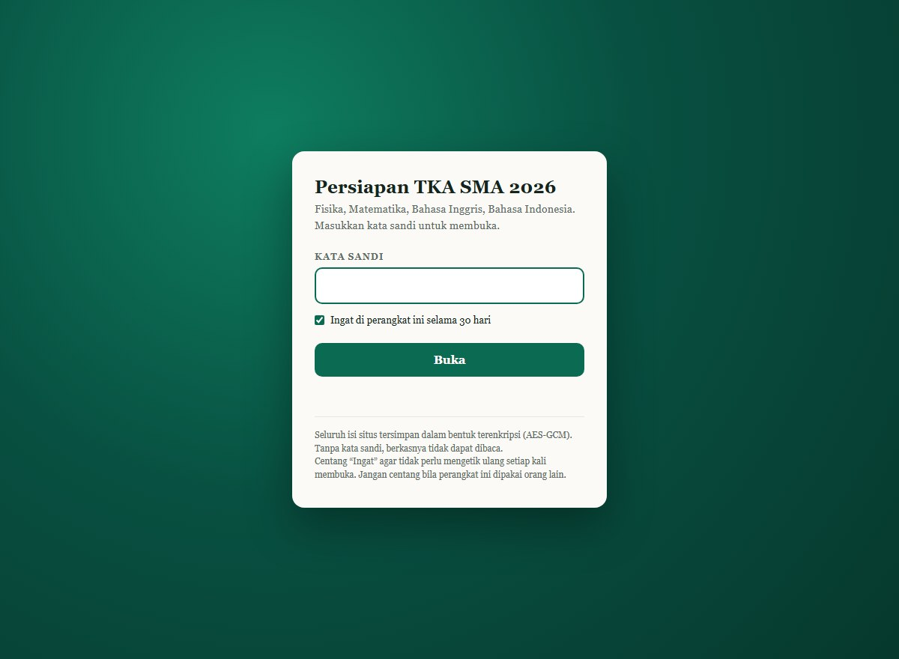
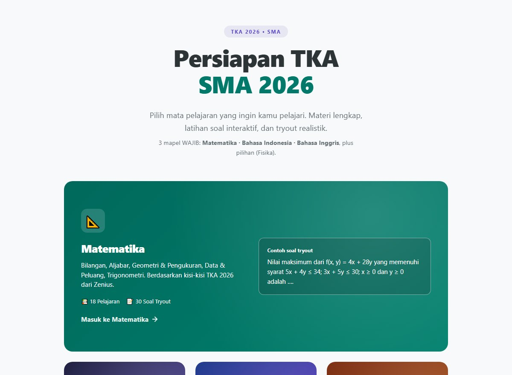

# Persiapan TKA SMA 2026

Materi belajar untuk TKA (Tes Kemampuan Akademik) 2026, untuk siswa SMA yang
mau latihan soal dengan pembahasan, bukan sekadar membaca rangkuman. Tiga mapel
wajib (**Matematika, Bahasa Indonesia, Bahasa Inggris**) plus satu mapel pilihan
(**Fisika**).

**Situs:** https://rendyyxyz.github.io/Teaching-TKA/ · [minta akses lewat GitHub](https://github.com/rendyyxyz)

Situsnya terkunci dengan kata sandi. Buka tautan profil di atas, lalu hubungi
lewat GitHub atau buka issue di repositori ini.

Yang membedakan halaman tryout Matematika: 25 dari 30 soalnya memakai angka yang
dihasilkan generator, jadi kamu berlatih metodenya, bukan menghafal jawabannya.
Angkanya tetap sama kalau halaman dimuat ulang, supaya pekerjaanmu tidak hilang
saat tab tertutup. Tombol **"Ganti angka soal ini"** memberi variasi baru kapan
pun kamu mau.

---

## Tentang repositori ini

Ini adalah **build publik** dari proyek pribadi. Riwayat commit di sini mengikuti
tanggal pengerjaan aslinya, sejak 26 September 2026, tetapi isinya adalah hasil
build terenkripsi pada tiap tanggal, bukan kode sumbernya.

Kode sumber dan riwayat pengembangan lengkap tersimpan di repositori privat. Yang
dipublikasikan di sini hanya hasil build yang sudah terenkripsi, supaya isi
pelajaran tidak dapat dibaca tanpa kata sandi.

## Sekilas

| Halaman kunci | Hub |
|---|---|
|  |  |

> Tangkapan layar isi pelajaran sengaja tidak dipublikasikan di sini. Situsnya
> terkunci dengan kata sandi, dan gambar isi pelajaran di repositori publik akan
> membuka apa yang seharusnya dilindungi.

---

## Isi

| Mata pelajaran | Status | Materi |
|---|---|---|
| **Matematika** | Wajib | Bilangan, aljabar, geometri, trigonometri, data & peluang |
| **Bahasa Indonesia** | Wajib | Teks informasi & fiksi, gagasan utama, hubungan antarparagraf |
| **Bahasa Inggris** | Wajib | Reading comprehension, text types, grammar |
| **Fisika** | Pilihan | Kinematika, dinamika, termal, gelombang, optik, listrik |

Tiap mapel punya materi bertahap, bank soal, dan latihan dengan pembahasan per
soal.

## Mesin tryout

Halaman tryout Matematika memuat 30 soal. 25 di antaranya memakai angka baru dari
generator, dan pembahasannya ikut dihitung ulang dari angka yang sama, jadi
langkah penyelesaiannya selalu cocok dengan soalnya.

Angka itu diambil dari seed acak yang disimpan di browser. Muat ulang halaman dan
papernya tetap sama, supaya kamu bisa berhenti di tengah tryout untuk menghitung
di kertas lalu melanjutkan tanpa kehilangan posisi. Tombol **"Ganti angka soal
ini"** di tiap soal memberi variasi baru tanpa mengubah soal lain.

Lima soal sisanya sengaja tidak diacak (soal 14 sampai 18). Semuanya soal
geometri dan bangun ruang yang bergantung pada gambar, dan gambarnya itu sendiri
adalah pertanyaannya.

## Keamanan

Repositori publik ini memuat materi belajar privat, dan enkripsi adalah cara
materinya tetap privat meski repositorinya terbuka. Tanpa kata sandi, isi
repositori hanya berupa ciphertext.

Rinciannya, kalau kamu ingin memeriksa: isi situs dienkripsi AES-256-GCM, kunci
diturunkan dari kata sandi dengan PBKDF2-SHA256 sebanyak 1.000.000 iterasi, dan
nama berkas isi di-hash sehingga daftar halamannya tidak terbaca dari repositori.
Dekripsi dilakukan di browser oleh service worker, jadi tidak ada server yang
perlu dijalankan. Seluruhnya HTML, CSS, dan JavaScript murni, tanpa framework
dan tanpa dependensi npm.

## Lisensi

Hak cipta dilindungi, lihat [LICENSE](LICENSE).

Soal-soal pada halaman tryout Matematika diturunkan dari kertas ujian **TO-1 TKA
Mapel Wajib, PROSUS INTEN (TA 2025/2026)** dan tetap menjadi milik penerbitnya.
